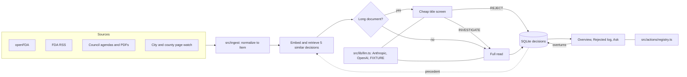

# Peachtree

A compliance radar for Atlanta restaurants and food trucks. Each morning an agent reads recall and regulatory sources, triages every item against a store profile, and surfaces only what the owner must act on. Everything rejected is logged with a one-line reason, and any rejection can be overturned. Overturns feed later triage.

Silence is the product.

## Setup

Needs Node 20 or later. No keys are required.

```bash
npm install && npm run seed && npm run dev
```

Open http://localhost:3000. All demo content is invented: no real firm, recall or ordinance appears in it.

| Command | What it does |
| --- | --- |
| `npm run seed` | Wipes the database and rebuilds the demo through the real pipeline |
| `npm run radar:run` | Runs the daily job |
| `npm run radar:reset` | Same as seed, for a daily cron |
| `npm test` | Runs the vitest suite |

Demo data also resets itself on the first page load of a new day. That wipes demo overturns and profile edits.

## Going live

Copy `.env.example` to `.env`, then export it for the job (`tsx` does not load `.env` itself).

- `ANTHROPIC_API_KEY` or `OPENAI_API_KEY` turns on real triage and chat. With neither, FIXTURE mode uses canned rules.
- Real embeddings need `OPENAI_API_KEY`. Otherwise a local hashed embedding is used, including alongside Anthropic.
- `RADAR_SOURCES=live` fetches real sources. Run this on a database without the demo, or the daily reset will wipe it: delete the `demo_date` row from `meta` after entering your own profile.

A source that fails is named in the Overview header and is never replaced with fixture data, because silence must not read as all clear. Fixture PDFs are therefore the fallback for demo runs only.

As of the last check, atlantaga.gov and dekalbpublichealth.com answer automated requests with 403, so those watched pages show as unavailable in live mode. They need an allowed fetch route or a manual check.

## Architecture



| Module | Job |
| --- | --- |
| `src/ingest/` | One fetcher per source, each returning `Item[]` |
| `src/agent/triage.ts` | Two-stage decision for one item |
| `src/agent/fixtureBrain.ts` | Canned decisions for zero-key runs |
| `src/agent/retrieve.ts` | Embeddings and similar past decisions |
| `src/agent/ask.ts`, `tools.ts` | Chat loop and DB tools |
| `src/actions/registry.ts` | Every item button. Add one entry to add an action |
| `src/lib/llm.ts` | Provider wrapper |
| `src/lib/store.ts` | All database reads and writes |

Partners: the `partner_runs` table and `Item.partnerRuns` are in place and unused.

## 90-second demo

1. **0:00 Overview.** "60 items read, 21 surfaced." The owner never saw the other 39.
2. **0:15 Needs action.** Open the Sunbelt Produce recall. It names a supplier this truck carries, with a suggested action.
3. **0:30 Different counties.** Open Rejected and find the Cobb and Gwinnett notices: this truck works Fulton and DeKalb only.
4. **0:40 Two-stage read.** Find the bond refunding resolution in Rejected. It was dropped on its title. The vending ordinance's staff report PDF was read in full and carries a deadline.
5. **0:55 Feedback.** Under To check, open "Moreland Ave milling project phase two". The owner overturned phase one, so this one surfaced by precedent, though it is off the usual route.
6. **1:10 Ask.** "What do I need to do today?" then "When do my permits expire?"
7. **1:25 Share.** Share via email opens a plain-text brief.
