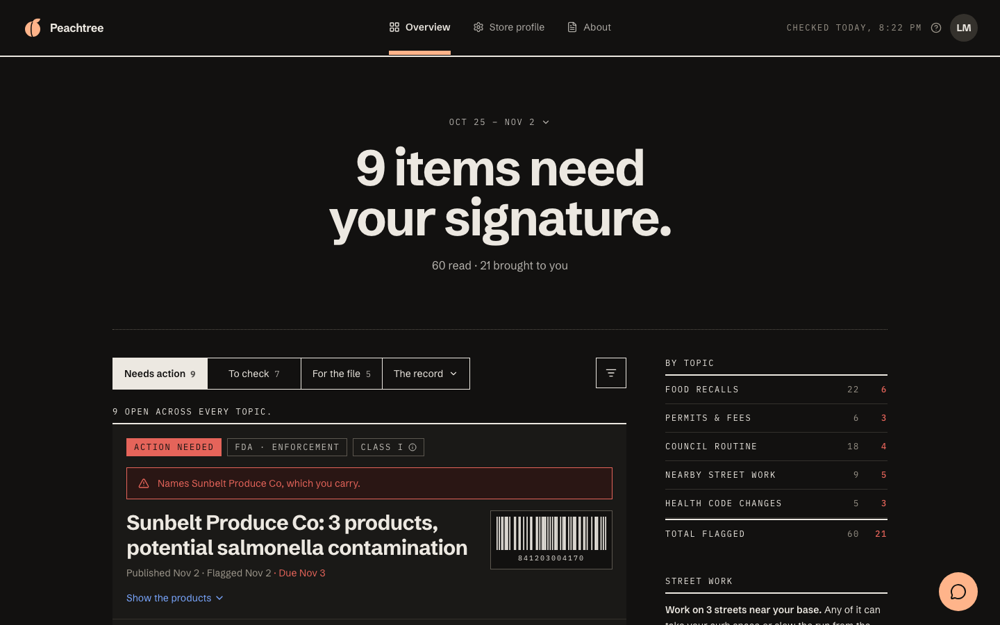
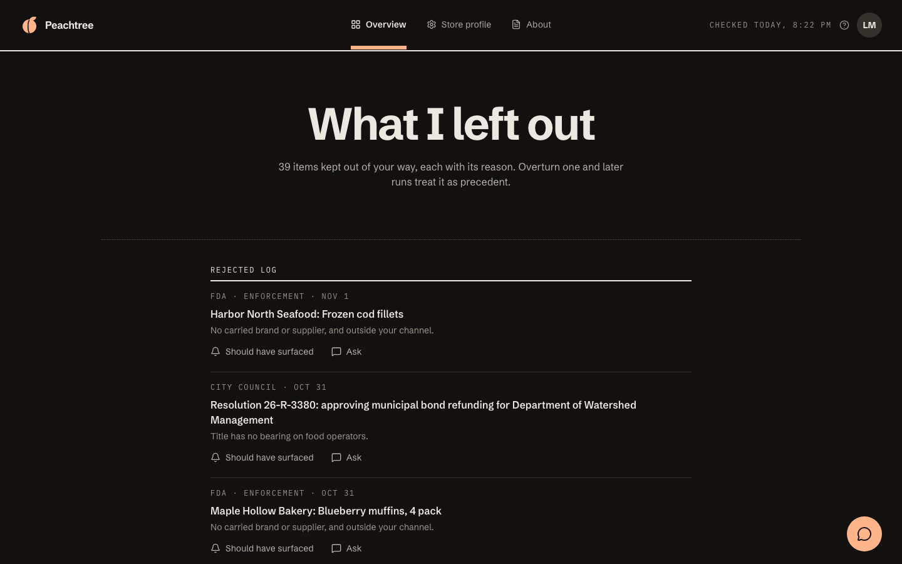
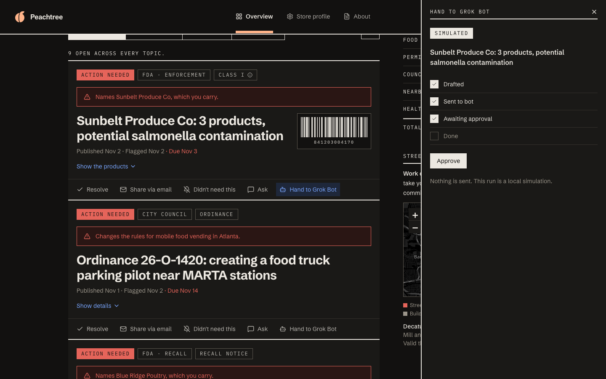
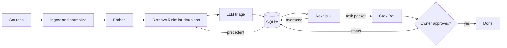

# Peachtree

A compliance radar for restaurants and food trucks in Atlanta that shows the owner only what they must act on.

## What it does

An Atlanta food business answers to the FDA, its county Board of Health (Fulton or DeKalb), the city, and Atlanta Police. Trucks need a health permit in each county they work. Nobody running a kitchen has time to read all of that.

Silence is the product. Each morning Peachtree:

- Reads recall and regulatory sources.
- Triages every item against a store profile: permits, counties, commissary, suppliers, location.
- Logs every rejection with a one-line reason.
- Lets the owner overturn any call. Overturns are retrieved as examples on later runs.
- Screens long documents by title first, and gives only survivors a full read.
- Answers questions in Ask the radar, grounded in its database.
- Shares any item as a plain-text email brief.

## Screenshots





## How it works



## Agent partner: Grok Bot

Hand to Grok Bot on a surfaced item creates a task packet. The run moves through Drafted, Sent to bot and Awaiting approval, then stops at the approval gate until the owner approves. See the [playbook](docs/PLAYBOOK.md).

- **Local demo:** `PARTNER_MODE=simulated` is the default. It is labeled SIMULATED and sends nothing. `PARTNER_MODE=manual` shows a copy-ready packet, and the owner sets the status by hand.
- **Recorded real run:** link to come. `<!-- add link -->`

This repo has no live Grok Bot connection.

## Built with Cursor

The repo is set up for agents:

- [AGENTS.md](AGENTS.md): working rules.
- [.cursor/rules](.cursor/rules/project.mdc): points Cursor at those rules.
- [docs/TASKS](docs/TASKS/README.md): task briefs.
- [docs/DEVLOG.md](docs/DEVLOG.md): log of finished tasks.

| Task | Evidence |
| --- | --- |
| No tasks recorded yet | `<!-- add link -->` |

## Run it locally

No keys or internet needed after install.

```bash
npm install
```

```bash
npm run demo:setup
```

```bash
npm run dev
```

Open http://localhost:3000. To return to the exact demo state between takes:

```bash
npm run demo:reset
```

Optional settings are in [.env.example](.env.example).

## Demo walkthrough

Full script: [docs/DEMO.md](docs/DEMO.md).

1. Overview: 60 read, 21 brought to you.
2. Needs action: Sunbelt Produce Co, Show the products.
3. The record, Rejected log: resolution 26-R-3380.
4. Document analysis: Ordinance 26-O-1412, Show details.
5. To check: Moreland Ave milling project phase two, the feedback example.
6. Chat button: "What do I need to do today?"
7. Share via email on the Sunbelt card.
8. Hand to Grok Bot, then Approve.

## Data sources and limits

Everything in the demo is a fixture. All firms, recalls, ordinances and street jobs are invented.

| Source | In the demo | Live (`RADAR_SOURCES=live`) |
| --- | --- | --- |
| openFDA food enforcement | Fixture | Works |
| FDA recall RSS | Fixture | Works |
| Atlanta City Council agendas | Fixture HTML and PDFs | Not working: no document links on a static scrape, reported as a failure |
| Fulton County health notices | Fixture | Environmental health page works; food service page failed in the last check |
| DeKalb County health notices | Fixture | Blocked with 403 |
| Atlanta permit and street notices | Fixture | City planning page fetched; DOT page failed |
| Street work map | Fixture | No live source |

Map tiles need internet. Offline, the map shows a plain background and markers. Peachtree can miss things and is not legal advice.

## Tech stack, structure, tests, license

Next.js 14, TypeScript, Tailwind, shadcn-style components, SQLite with better-sqlite3, Leaflet.

```text
src/ingest/    one fetcher per source
src/agent/     triage, retrieval, chat, demo seed
src/partners/  Grok Bot handoff
src/actions/   item button registry
src/lib/       database, LLM wrapper, helpers
fixtures/      demo data
docs/          demo script, playbook, design system
```

| Command | Checks |
| --- | --- |
| `npm test` | Unit tests |
| `npm run smoke` | Production build, pages and API routes |
| `npm run e2e` | Clicks the demo path, fails on console errors |

License: none chosen yet.
